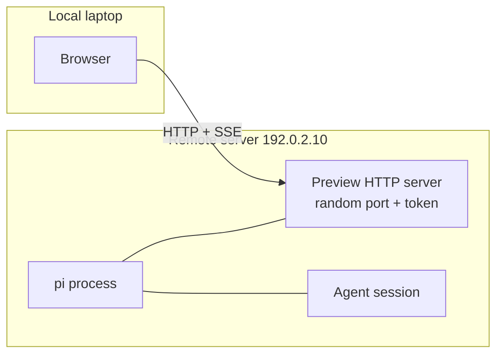

# Remote Access Guide: Listen Address, Browser Host, and Agent Chat

English | [简体中文](remote-access.zh-CN.md)

> Use case: pi runs on a remote server (usually Linux, headless), while your browser runs on your laptop. The goal is to get three things working end to end:
>
> 1. Agent-written Markdown is rendered into a web page on the remote server;
> 2. You can open the preview link in your local browser;
> 3. You can **select text and ask the Agent** in the page, or use the **chat area at the bottom of the page** for a multi-turn conversation.
>
> This guide explains the two things around `/md-preview-host` — **where the service listens** and **which host the URL uses** — and gives a remote walkthrough you can follow step by step.

## 0. TL;DR

| What you want | How to do it |
| --- | --- |
| Make the remote preview server reachable from other machines | Set `MD_PREVIEW_BIND=0.0.0.0` (or a LAN IP) before starting pi, then restart pi |
| Make links / the auto-opened browser point at the right IP | Persist with `/md-preview-host <ip or hostname>`; or per call: `/md-preview <file> --host <ip>` |
| View remotely without exposing a port | Keep the default `127.0.0.1` bind and forward a local port with `ssh -L` |
| Pin the access token | Set `MD_PREVIEW_TOKEN=<long random string>` before starting pi |
| Use selection Q&A / bottom chat remotely | No extra setup: both share the preview URL, port and token; just keep the pi session running |

The two most common traps:

- **`/md-preview-host` only changes the host inside the URL; it does not change the listen address.** The listen address is set by `MD_PREVIEW_BIND` only, and the preview server has to start again for a changed value to apply (usually by restarting pi).
- **The `md_preview` tool has no host parameter.** When the agent calls it, the URL uses the persisted setting (`/md-preview-host`) or the bind fallback. In a remote setup, persist the target host first; otherwise the agent may generate a `127.0.0.1` URL.

## 1. Two addresses to keep apart

A preview URL looks like this:

```text
http://<browser host>:<random port>/doc/<doc-id>?token=<access token>
       └── address the reader's browser uses ──┘  └ random per start ┘      └ checked on every route ┘
```

| Part | Comes from | Can it be fixed? | Read at |
| --- | --- | --- | --- |
| Browser host | `--host` (per call) > `/md-preview-host` (persisted) > bind fallback | Persistable | Every preview call |
| Port | Randomly assigned by the preview server (Node `listen(0)`) | **No** | Server start |
| token | `MD_PREVIEW_TOKEN`, otherwise generated randomly at startup | Yes, via env var | Server start |

### 1.1 Listen address (bind)

- Env var: `MD_PREVIEW_BIND`, default `127.0.0.1`.
- Common values: `0.0.0.0` (all interfaces), `::` (all IPv6 interfaces), a specific NIC IP such as `192.0.2.10`.
- Read at: **preview server startup** (the first preview or `/md-preview` in the session).
- The preview server is a **per-session singleton**: once it has started, its bind address is fixed. Changing the env var mid-session will not rebind the running server; restart pi to start it at the new address.
- It only decides where the service listens; it does not decide which host appears in the URL.

> This variable was renamed from `MD_PREVIEW_HOST`. The old name is still accepted as a deprecated alias, and `MD_PREVIEW_BIND` wins when both are set.

### 1.2 Browser host

- Per call: `/md-preview <file> --host <ip-or-hostname>`.
- Persisted: `/md-preview-host <ip-or-hostname>` writes the user-level config file, shared by all pi instances. It is read on every preview call and **takes effect from the next preview**; no restart is needed.
- It only rewrites the host of the URL; **the port and token are preserved**.
- The auto-opened browser and the printed link share the same URL, so this host decides both "which address is opened" and "which address is written into the copied link".
- Fallback: with neither a per-call `--host` nor a persisted value, the bind address is used; however, **a wildcard bind (`0.0.0.0` / `::`) falls back to loopback `127.0.0.1`**, because a wildcard address cannot be a browser target.

### 1.3 Why they must be separate

A remote server may have multiple NICs, Docker/NAT, or a firewall: the service has to bind `0.0.0.0` (or a LAN IP) to be reachable, while the URL must be an address the **reader's browser can resolve and reach** (LAN IP, VPN address, or domain). Conflating the two produces either "the service is up but the link does not open" or "the link opens, but the browser was asked to open loopback".



## 2. Command and configuration cheat sheet

### 2.1 `/md-preview-host`

```text
/md-preview-host                # show: persisted value, effective value + source, bind address, settings file path
/md-preview-host 192.0.2.10   # persist the browser host (user-level config)
/md-preview-host [::1]          # IPv6 in brackets; stored as ::1
/md-preview-host --clear        # remove the persisted value, fall back to the bind address
```

Accepted values:

- Hostname: `my-pc.example.com`, `preview.example.com`;
- IPv4: `192.0.2.10`;
- IPv6: bare `::1` / `fe80::1%en0`, or bracketed `[::1]`;
- **Not accepted**: scheme, path, or port — `http://…`, `host/path`, `host:8080`, `[::1]:8080` are rejected with an explicit error.

Output after saving looks like:

```text
Browser host saved: `192.0.2.10` — every preview (this and any other pi instance) opens at this host from its next preview on.

An explicit `--host` on `/md-preview` still overrides this per call; `/md-preview-host --clear` removes it.
```

When showing the setting, the output carries four key lines:

```text
Markdown preview browser host:
- Persisted setting: 192.0.2.10
- Effective for the next preview: 192.0.2.10 (source: persisted setting)
- Server bind: 0.0.0.0 (running)
- Settings file: ~/.config/md-preview/settings.json

Precedence: explicit `/md-preview <file> --host <ip>` > persisted setting > server bind address.
The setting is read at every preview call, so all pi instances use it from their next preview on.
```

A few points:

- The value lives in the user-level file `$XDG_CONFIG_HOME/md-preview/settings.json` (`~/.config/md-preview/settings.json` when `XDG_CONFIG_HOME` is unset) and is **shared by all pi instances of the same account**.
- The preview page **cannot** change this value (`POST /prefs` accepts only theme / background / font scale / line height); only the command in a pi session can set it.
- If the target host is outside the listen address, the setting still succeeds but carries the same warning as `--host` (see §2.4).

### 2.2 `/md-preview --host`

```text
/md-preview reports/q3.md --host 192.0.2.10
/md-preview reports/q3.md --host=192.0.2.10
/md-preview --host "192.0.2.10" reports/q3.md
```

- Affects **this preview only**; it takes precedence over the persisted setting.
- Only rewrites the URL host; the port and `?token=` are preserved.
- Pass a bare IP or hostname: `http://` or a path is rejected explicitly; a port is not understood (the link falls back to the server-generated host). The port always comes from the preview server; do not specify it yourself.
- A missing value, a duplicate flag, or a URL-like value is rejected with an explicit error — **no wrong link is opened**.
- This option exists only on the `/md-preview` command; the `md_preview` tool used by the agent does not have it.

### 2.3 Environment variables

| Variable | Effect | Read at |
| --- | --- | --- |
| `MD_PREVIEW_BIND` | Bind address of the preview server, default `127.0.0.1` | Preview server startup |
| `MD_PREVIEW_TOKEN` | Fixed access token, overriding the token generated randomly at startup | Preview server startup |

- Use a long URL-safe random string for `MD_PREVIEW_TOKEN`, for example `openssl rand -hex 24`. A pinned token survives server restarts (the port still changes), which is handy for bookmarks and shared links.
- Set the variable in the process or script that starts pi; changing it after the server has started has no effect.

### 2.4 Precedence and the mismatch warning

```text
per-call --host  >  /md-preview-host persisted value  >  bind address (wildcard bind falls back to loopback)
```

When the target host is clearly outside the listen address (for example, bound to `127.0.0.1` but opening a LAN IP), the preview is still generated, but the command output and UI notification carry a warning:

```text
the preview server is listening on 127.0.0.1 only, so http://192.0.2.10:52814/... may not be reachable.
Set MD_PREVIEW_BIND=0.0.0.0 (or MD_PREVIEW_BIND=192.0.2.10) and restart pi to serve that address.
The preview server is a per-session singleton: it keeps its original bind even if MD_PREVIEW_BIND changes mid-session - the new value only takes effect after a restart.
```

When you see it, first confirm whether `MD_PREVIEW_BIND` really took effect, then restart pi.

## 3. Case: pi on a remote server, browser on your laptop

### 3.1 Assumptions

- Remote server: Linux, IP `192.0.2.10` (documentation range), headless;
- The pi session, repository, and agent all live on the server, project directory `~/project`;
- Your laptop and the server are on the same LAN / VPN; the browser runs on the laptop;
- The port `52814`, document id `d1`, and token below are examples; always use the actual output.

### 3.2 Option 1: Direct LAN / VPN access (fastest)

**Step 1: start pi on a reachable address.**

```bash
# after SSH-ing into the remote server
export MD_PREVIEW_BIND=0.0.0.0
export MD_PREVIEW_TOKEN="$(openssl rand -hex 24)"   # optional: pin the token
pi
```

- `0.0.0.0` listens on all interfaces; to expose only the LAN NIC, use `MD_PREVIEW_BIND=192.0.2.10` (the IP must exist on the server).
- These variables are read when the preview server starts; if you have already opened a preview, restart pi.

**Step 2: tell pi which address the browser should use.**

```text
/md-preview-host 192.0.2.10
```

A hostname the laptop can resolve works too, for example `/md-preview-host devbox.example.com`.

Verify with `/md-preview-host`:

```text
Markdown preview browser host:
- Persisted setting: 192.0.2.10
- Effective for the next preview: 192.0.2.10 (source: persisted setting)
- Server bind: 0.0.0.0 (running)
- Settings file: ~/.config/md-preview/settings.json
```

> Do this first. The `md_preview` tool has no host parameter; only after persisting will the agent generate `http://192.0.2.10:…` instead of `127.0.0.1`.

**Step 3: generate and open the preview.**

Ask the agent to produce the document and call the preview tool (recommended), or run the command directly in the session:

```text
/md-preview reports/q3.md
```

The output looks like:

```text
Markdown preview is ready: **Q3 Research Report**
- Page URL: <http://192.0.2.10:52814/doc/d1?token=…>
- Source file: `~/project/reports/q3.md`
- Browser: Could not open the browser automatically; open the URL above manually
- Live sync: the page refreshes automatically when the file changes; no need to call this tool again
- Auto-exit: the preview server stops once the user closes the browser tab, so you do not need to keep working or poll its status
```

- On a headless server, auto-opening the browser usually does not work; even if the `Browser:` line says it opened, the remote side may have no window (`xdg-open` fails silently). For remote reading, always use the `Page URL` and copy it **in full** to your local browser.
- **Do not drop `?token=…`**, or every route returns `401`.
- If the server firewall is enabled, allow the example port (random per session; see §3.3 SSH tunnel and §3.5 comparison).

**Step 4: read in the local browser and talk to the Agent.**

- The preview page loads normally; TOC navigation, code highlighting, theme switching and so on all run in your local browser.
- **Selection Q&A**: select any paragraph → click the floating "✦ Ask" button → type a question and press Enter. The page first shows a pending reply card; the remote pi session receives the injected message, the agent reads the relevant files and calls `md_preview_reply`, and the reply card appears beside the document in real time with the quoted text highlighted in orange.
- **Bottom chat**: scroll to the "Chat with the Agent" area at the end of the document and type a question about the whole document (no selection needed). The message is injected into the remote session together with a summary of recent chat turns; the agent's reply appears as an "Agent" message in the chat area (newest first).
- Both paths use the **same URL, port, and token** as the preview; no extra port, command, or WebSocket is needed.
- The initial UI language follows the `ui_lang` passed by the agent to `md_preview` (the `/md-preview` command uses `MD_PREVIEW_LANG` > `en`); readers can switch between 中 / EN from the top-right corner at any time.

**Step 5: lifecycle and reopening.**

- 8 seconds after **all** tabs close, the preview server exits; if no tab ever connects, it exits after 5 minutes.
- After the server exits, old links stop working. Previewing again (via the agent or `/md-preview`) starts a new server with **a new random port** (usually different); if `MD_PREVIEW_TOKEN` is not pinned, the token changes too — use the new output.
- Laptop sleep, Wi-Fi changes, or VPN reconnects can drop the SSE connection; the server treats "no viewers" for 8 seconds as all tabs being closed and exits. Just preview again.
- Q&A history lives in the preview server's memory: while the server is alive, refreshing / reopening the page restores cards and chat records; once the server exits, the history goes with the process.

### 3.3 Option 2: SSH tunnel (recommended for public / untrusted networks)

No listen-address change, no firewall change; the server keeps its default loopback bind:

**Remote server:**

```bash
pi    # keep the default MD_PREVIEW_BIND=127.0.0.1
```

```text
/md-preview reports/q3.md
```

Suppose the output URL is:

```text
http://127.0.0.1:52814/doc/d1?token=…
```

**Local laptop:**

```bash
ssh -N -L 52814:127.0.0.1:52814 user@192.0.2.10
```

Then open the **exact same URL as the remote output** in the local browser:

```text
http://127.0.0.1:52814/doc/d1?token=…
```

- If the local port is already in use, map a different local port and change the port in the browser accordingly:
  ```bash
  ssh -N -L 8080:127.0.0.1:52814 user@192.0.2.10
  # open http://127.0.0.1:8080/doc/d1?token=… in the browser
  ```
  The token, path, and query string stay the same; only the origin changes (`localStorage` theme/language memory does not carry over, but server-side user preferences still apply).
- Advantages: no `MD_PREVIEW_BIND`, no firewall change, traffic encrypted by SSH, and the service still listens on loopback only.
- Note: the preview server gets a new port when it restarts, so the tunnel must be recreated for the new port. The tunnel itself can stay up, but the URL on the old port stops working once the server exits.
- Agent chat also goes through this tunnel: browser → SSH → remote server → inject into the remote pi session, with SSE replies coming back the same way.

### 3.4 Option 3: Reverse proxy / public domain (advanced, with care)

When you need a stable domain or HTTPS, put a reverse proxy such as nginx or Caddy in front:

- The listen address can stay `127.0.0.1` (when the proxy runs on the same host), and `/md-preview-host preview.example.com` makes links use the proxy domain. The extension cannot see the reverse proxy and will warn that the host is outside the listen address; ignore that warning once the proxy configuration is confirmed.
- **Proxy by host / subdomain, not by a path prefix.** Preview routes are root-absolute: `/doc/…`, `/asset/…`, `/mermaid.mjs`, `/prefs`; rewriting under a `/preview/` prefix easily breaks the page, SSE, and static assets together.
- **Disable proxy buffering for SSE** and relax read timeouts, e.g. for nginx: `proxy_buffering off;`, `proxy_read_timeout 3600s;`; otherwise questions and replies may be delayed or lost.
- **The port is random per session**, so the proxy upstream has to follow the current port (read it from the output URL); a new preview may require a proxy config change. This is the biggest operational cost of this option.
- TLS terminates at the proxy; the token is still required. Because the token appears in URLs, browser history, and proxy logs, public deployments should also add a VPN, IP allowlist, or extra authentication.

### 3.5 Comparison

| Option | Exposes a port? | Main cost | Best for |
| --- | --- | --- | --- |
| Direct LAN / VPN | Yes (`0.0.0.0` + random port) | Firewall allow + port changes | Trusted LAN, temporary demos |
| SSH tunnel | No (loopback only) | Recreate the tunnel with each new port | Public or untrusted networks, **preferred** |
| Reverse proxy | Yes (proxy entry only) | Proxy + TLS + SSE tuning + follow the random port | Teams needing a stable domain / HTTPS |

### 3.6 Remote check list

- [ ] `/md-preview-host` shows both persisted and effective values as the target IP, and `Server bind` shows `0.0.0.0 (running)` (direct option);
- [ ] The URL host is reachable from the browser and the port is reachable locally;
- [ ] The page opens without a `401` (token intact);
- [ ] Selecting text and asking a question returns an agent reply card;
- [ ] Sending a message in the bottom chat area returns an agent reply;
- [ ] Close the tab and reopen quickly (within the ~8 second window); Q&A cards are still there (the server is alive);
- [ ] Preview another document and confirm the new port / URL is still reachable.

## 4. Agent chat path (remote view)

```mermaid
sequenceDiagram
    participant B as Local browser
    participant S as Remote preview server
    participant A as Remote Agent session
    B->>S: Open preview URL (?token=…)
    S-->>B: Document page + SSE stream
    B->>S: Selection question POST /doc/{id}/ask
    B->>S: or bottom chat POST /doc/{id}/chat
    S-->>A: sendUserMessage (deliverAs: followUp by default; steer optional)
    A->>A: Read repository files and answer
    A->>S: md_preview_reply
    S-->>B: SSE answer → reply card / chat message
```

### 4.1 Two entry points

| Item | Selection Q&A | Bottom chat |
| --- | --- | --- |
| Trigger | Select body text → floating "✦ Ask" | Type directly in the chat box at the end of the document |
| Injected content | Quoted text + question | Whole-document message + recent 5 chat turns |
| Reply display | Card beside the document (quote / reply / time), quoted text highlighted in orange | "Agent" message in the chat area (newest first) |
| Best for | Follow-up on one passage | Whole-document questions / multi-turn discussion |

### 4.2 Prerequisites for remote use

1. **The pi session must still be running**: the preview server and message injection both live in that process; if pi exits, the page goes away.
2. **The browser can reach the preview URL**: reachable host, open port, firewall / security group allowing it (or an SSH tunnel).
3. **The SSE stream is not broken**: intermediate proxies must not buffer it or use too-short idle timeouts, or questions will not appear and replies will be delayed.
4. **The URL must carry the token**: the page, SSE, `/ask`, `/chat`, `/prefs`, and static assets all validate it.
5. **The agent can receive the injected message and reply**: an idle session is woken immediately. With the default **Follow up** mode, a busy session queues the message until the current turn ends; **Steering** instead injects it after the current tool batch completes.

### 4.3 Behavior details and limits

- Selection Q&A and bottom chat have separate caps: **50 selection questions / 100 bottom-chat messages per document**; older entries are evicted first.
- Bottom-chat injection carries only a **recent 5-turn** history summary (each excerpt at most ~300 characters, code blocks collapsed and counted); older records do not enter the context.
- Unanswered entries show a pending state; when exporting an HTML snapshot, unanswered entries are statically annotated as "still unanswered at export time".
- On narrow screens (< 1080px) the left rail holding selection reply cards is hidden and only the orange highlight remains; bottom chat is unaffected.
- Q&A data exists only in the preview server's memory; it is cleared when the server exits, and old Q&A is not restored when a document is previewed again.

## 5. Security checklist

- By default the server listens on `127.0.0.1` only. Exposing it is explicit opt-in (`MD_PREVIEW_BIND`); **do not expose the random port directly to the public internet on an untrusted network**.
- Every route requires `?token=`; the link is the credential. Do not post token-bearing URLs to public channels.
- Pin a sufficiently long random token with `MD_PREVIEW_TOKEN`; without it, a 192-bit random value is generated at startup, which is strong enough.
- The project has **no built-in TLS**. For public access, use an SSH tunnel, a VPN, or terminate HTTPS at a reverse proxy.
- `0.0.0.0` listens on every reachable interface (including a public NIC). Prefer a specific LAN IP when possible.
- The page itself makes no external network requests (no CDN, no external assets), but the token can end up in browser history, terminal output, and proxy logs.
- On a shared server, each pi session has its own random port and token; `browserHost` is user-level config, so accounts do not affect each other.

## 6. Troubleshooting

| Symptom | Likely cause | Fix |
| --- | --- | --- |
| `401 Missing or invalid access token` | URL missing the token / token truncated / proxy stripped the query | Copy the full URL; check that the proxy preserves `?token=` |
| `ERR_CONNECTION_REFUSED` | Server bound to loopback only, exited, port blocked, or host unreachable | Check `MD_PREVIEW_BIND`; confirm the server is running; allow the port or use an SSH tunnel; preview again after the server exits |
| Output contains `listening on 127.0.0.1 only … may not be reachable` | Target host outside the bind range | Restart pi with `MD_PREVIEW_BIND=0.0.0.0` (or the target IP); remember the per-session singleton |
| Changed `MD_PREVIEW_BIND` but nothing changed | The preview server is already running and its bind is fixed; env vars belong to the pi process | Restart pi with the new environment |
| `/md-preview-host` is set but the URL is still `127.0.0.1` | Setting did not save, a per-call `--host` overrode it, or you are looking at an old link | Run `/md-preview-host` to see persisted / effective / source; preview again |
| Auto-open failed / no window | Headless remote server | Normal; open the printed Page URL manually |
| Page opens but questions do nothing | SSE buffered by a proxy, session exited, or message queued | Check the proxy config; confirm the pi session is alive; see whether the card is pending |
| Question is recorded but no reply appears | Agent did not call `md_preview_reply`, or `question_id` does not match | Ask the agent to reply again; omit `question_id` to answer the earliest unanswered question |
| Reopening after closing the tab gives 404 / connection failure | Server exited by policy (8 s / 5 min) | Preview again; Q&A history is lost |
| `--host` errors or has no effect | `http://` / a path / duplicates / a missing value are rejected; a port is ignored | Pass a bare IP / hostname; let the server supply the port |
| IPv6 address does not open | Bracketed form not used | Use `[::1]` in the browser URL; `/md-preview-host [::1]` on the command line |
| Port is different every time | By design (`listen(0)`; no fixed-port option) | Read it from the output URL; pinning the token with `MD_PREVIEW_TOKEN` does not fix the port |

## 7. Design boundaries (why it cannot be simpler)

- **Random port**: avoids port conflicts and pre-allocation, at the cost of reading the port from the output each time remotely, and there is no fixed-port option such as `MD_PREVIEW_PORT`.
- **Host and bind are separate**: the server may bind `0.0.0.0`, but the browser should only see a concrete reachable address; a wildcard address cannot be a URL target.
- **browserHost is user-level only**: the preview page cannot write it, which prevents a page from rewriting the target of shared links via `POST /prefs`.
- **Per-session singleton + auto-exit**: avoids a resident process, but remote use must keep a tab open; a disconnect longer than 8 seconds triggers exit.
- **Token in the URL**: trades for a simple "link is the credential" model; the cost is that the token lands in history and logs, so public deployments must add encryption and access control.

## 8. Related reading

- [README.md](../README.md) — Configuration → Listening address & access token; User-level preference persistence
- [README.zh-CN.md](../README.zh-CN.md) — the Chinese version of the same sections
- [demo/sample-report.md](../demo/sample-report.md) — a sample document you can use to verify remote preview and the Q&A round trip
