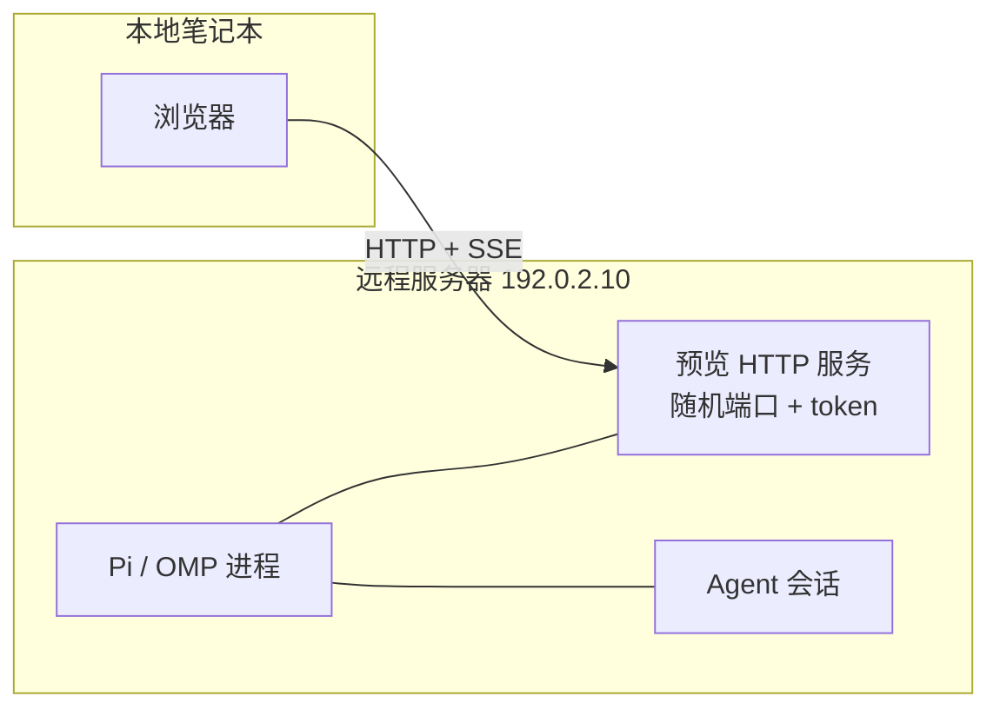
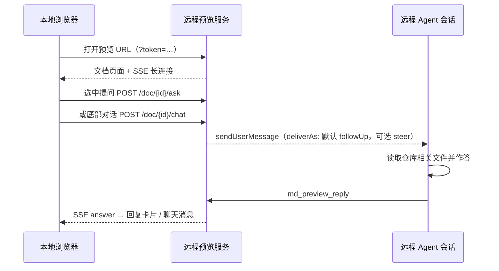

# 远程访问指南：监听地址、浏览器目标 IP 与 Agent 对话

[English](remote-access.md) | 简体中文

> 适用场景：Pi 或 OMP 运行在远程服务器上（通常是 Linux、无图形界面），浏览器在你本机。目标是把三件事一次跑通：
>
> 1. Agent 写出的 Markdown 能在远程渲染成网页；
> 2. 你能在本地浏览器打开预览链接；
> 3. 你能在页面上**选中文字向 Agent 提问**，或使用**页面底部的对话区**和 Agent 多轮交流。
>
> 本文讲清 `/md-preview-host` 相关的两件事——**服务监听在哪**、**URL 里用哪个 host 打开**——并给出可直接照做的远程案例。
>
> Pi 与 OMP 共用同一份源码、行为完全一致：下文命令以 `pi` 为例，在 OMP 下换成 `omp` 即可；环境变量、`/md-preview*` 命令、预览服务与页面完全相同。

## 0. 速览

| 你想做的事 | 做法 |
| --- | --- |
| 让远程预览服务能被其他机器访问 | 启动 Pi / OMP 前设置 `MD_PREVIEW_BIND=0.0.0.0`（或某个内网 IP），然后重启宿主 |
| 让链接 / 自动打开的浏览器指向正确 IP | `/md-preview-host <ip 或 hostname>` 持久化；或单次 `/md-preview <file> --host <ip>` |
| 不暴露端口也能远程看 | 保持默认监听 `127.0.0.1`，本地用 `ssh -L` 做端口转发 |
| 固定访问令牌 | 启动 Pi / OMP 前设置 `MD_PREVIEW_TOKEN=<长随机串>` |
| 远程使用选词问答 / 底部对话 | 无需额外配置：与预览共用同一个 URL、端口和 token，保持 Pi / OMP 会话运行即可 |

两个最容易踩的点：

- **`/md-preview-host` 只改 URL 里的 host，不改监听地址。** 监听地址只能通过 `MD_PREVIEW_BIND` 设置，且修改后要让预览服务重新启动（一般就是重启 Pi 或 OMP）。
- **`md_preview` 工具没有 host 参数。** Agent 调用工具时，用的是持久化设置（`/md-preview-host`）或绑定回退。远程场景应先持久化目标 host，否则 Agent 生成的链接可能是 `127.0.0.1`。

## 1. 先分清两个地址

预览 URL 的结构：

```text
http://<浏览器目标 host>:<随机端口>/doc/<doc-id>?token=<访问令牌>
       └── 读者浏览器访问的地址 ──┘  └ 每次启动随机 ┘      └ 所有路由都校验 ┘
```

| 组成 | 来自哪里 | 能否固定 | 读取时机 |
| --- | --- | --- | --- |
| 浏览器目标 host | `--host`（单次） > `/md-preview-host`（持久化） > 绑定回退 | 可持久化 | 每次预览调用时 |
| 端口 | 预览服务随机分配（Node `listen(0)`） | **不能固定** | 服务启动时 |
| token | `MD_PREVIEW_TOKEN`，未设置则启动时随机生成 | 可用环境变量固定 | 服务启动时 |

### 1.1 监听地址（bind）

- 环境变量：`MD_PREVIEW_BIND`，默认 `127.0.0.1`。
- 常用值：`0.0.0.0`（所有网卡）、`::`（所有 IPv6 网卡）、某个具体网卡 IP（如 `192.0.2.10`）。
- 读取时机：**预览服务启动时**（本会话第一次预览或执行 `/md-preview`）。
- 预览服务是**会话级单例**：一旦启动，绑定地址就固定了；会话中途修改环境变量不会让已在运行的服务重新绑定。需要重启 Pi 或 OMP 才会以新地址启动。
- 它只决定「服务开在哪」，不决定 URL 里写哪个 host。

> 该变量由 `MD_PREVIEW_HOST` 更名而来；旧名仍作为已弃用别名兼容，两者同时设置时以 `MD_PREVIEW_BIND` 为准。

### 1.2 浏览器目标 host

- 单次指定：`/md-preview <file> --host <ip|hostname>`。
- 持久化：`/md-preview-host <ip|hostname>`，写入用户级配置文件，所有 Pi / OMP 实例共用；每次预览调用时读取，**下一次预览立即生效**，不需要重启。
- 只改 URL 的 host，**端口与 token 原样保留**。
- 自动打开浏览器与打印的链接共用同一个 URL，所以这个 host 同时决定「自动打开哪个地址」和「复制到的链接里写哪个地址」。
- 回退规则：既没有单次 `--host`、也没有持久化值时，使用绑定地址；但**通配绑定（`0.0.0.0` / `::`）会回退为回环地址 `127.0.0.1`**，因为通配地址本身不能作为浏览器目标。

### 1.3 为什么必须分开

远程服务器可能有多张网卡、Docker/NAT 或防火墙：服务需要绑 `0.0.0.0`（或内网 IP）才能被访问，但 URL 必须是**读者浏览器真正能解析、能连通的地址**（内网 IP、VPN 地址或域名）。如果两者混在一起，就会出现「服务起来了、链接却打不开」或「链接能打开、自动打开的却是本机回环」的情况。



## 2. 命令与配置速查

### 2.1 `/md-preview-host`

```text
/md-preview-host                # 查看当前设置：持久化值、下一次预览实际使用的值及其来源、绑定地址、配置文件路径
/md-preview-host 192.0.2.10   # 持久化目标 host（写入用户级配置）
/md-preview-host [::1]          # IPv6 用方括号；保存时会规范化为 ::1
/md-preview-host --clear        # 清除持久化设置，回退到绑定地址
```

可接受的取值：

- 主机名：`my-pc.example.com`、`preview.example.com`；
- IPv4：`192.0.2.10`；
- IPv6：裸写 `::1`、`fe80::1%en0`，或方括号形式 `[::1]`；
- **不接受**协议、路径和端口：`http://…`、`host/path`、`host:8080`、`[::1]:8080` 都会被拒绝并给出明确错误。

保存成功后的输出类似：

```text
Browser host saved: `192.0.2.10` — every preview (this and any other Pi / OMP instance) opens at this host from its next preview on.

An explicit `--host` on `/md-preview` still overrides this per call; `/md-preview-host --clear` removes it.
```

查看设置时，输出包含四行关键信息（运行时文案为英文）：

```text
Markdown preview browser host:
- Persisted setting: 192.0.2.10
- Effective for the next preview: 192.0.2.10 (source: persisted setting)
- Server bind: 0.0.0.0 (running)
- Settings file: ~/.config/md-preview/settings.json

Precedence: explicit `/md-preview <file> --host <ip>` > persisted setting > server bind address.
The setting is read at every preview call, so all Pi / OMP instances use it from their next preview on.
```

几个要点：

- 设置保存在用户级文件 `$XDG_CONFIG_HOME/md-preview/settings.json`（未设置 `XDG_CONFIG_HOME` 时为 `~/.config/md-preview/settings.json`），**同一账号的所有 Pi / OMP 实例共享**。
- 预览页**不能**修改这个值（`POST /prefs` 只接受主题 / 背景 / 字号 / 行距），只能由你在 Pi / OMP 会话里用命令设置。
- 如果目标 host 不在监听范围内，设置仍会成功，但会附带与 `--host` 相同的警告（见 §2.4）。

### 2.2 `/md-preview --host`

```text
/md-preview reports/q3.md --host 192.0.2.10
/md-preview reports/q3.md --host=192.0.2.10
/md-preview --host "192.0.2.10" reports/q3.md
```

- 只影响**这一次**预览；优先级高于持久化设置。
- 只改写 URL 的 host，端口与 `?token=` 原样保留。
- 参数应传裸 IP 或主机名：带 `http://` 或路径会明确报错；带端口不会被识别（链接会退回服务端生成的 host）。端口始终由预览服务给出，不要手动指定。
- 缺失值、重复出现、写成 URL 等错误会直接报错，**不会打开错误的链接**。
- 该参数只存在于 `/md-preview` 命令；Agent 调用的 `md_preview` 工具没有这个参数。

### 2.3 环境变量

| 变量 | 作用 | 读取时机 |
| --- | --- | --- |
| `MD_PREVIEW_BIND` | 预览服务绑定地址，默认 `127.0.0.1` | 预览服务启动时 |
| `MD_PREVIEW_TOKEN` | 固定访问令牌，覆盖启动时随机生成的 token | 预览服务启动时 |

- `MD_PREVIEW_TOKEN` 建议使用 URL-safe 的长随机串，例如 `openssl rand -hex 24`。固定后 token 不随服务重启变化（端口仍会变），适合收藏/分享固定链接。
- 环境变量要在启动 Pi / OMP 的那个进程/脚本里设置；服务已经启动后再改无效。

### 2.4 优先级与不匹配警告

```text
单次 --host  >  /md-preview-host 持久化值  >  绑定地址（通配绑定回退到回环地址）
```

当目标 host 明显不在监听范围内（例如只绑了 `127.0.0.1`，却要打开局域网 IP），预览仍会生成，但命令输出和 UI 通知会给出警告：

```text
the preview server is listening on 127.0.0.1 only, so http://192.0.2.10:52814/... may not be reachable.
Set MD_PREVIEW_BIND=0.0.0.0 (or MD_PREVIEW_BIND=192.0.2.10) and restart the host (Pi or OMP) to serve that address.
The preview server is a per-session singleton: it keeps its original bind even if MD_PREVIEW_BIND changes mid-session - the new value only takes effect after a restart.
```

看到这段警告时，先确认 `MD_PREVIEW_BIND` 是否真的生效，再重启宿主。

## 3. 案例：Pi 或 OMP 跑在远程服务器，浏览器在本地

### 3.1 场景假设

- 远程服务器：Linux，IP `192.0.2.10`（文档示例网段），没有图形界面；
- Pi / OMP 会话、代码仓库、Agent 都在服务器上，项目目录 `~/project`；
- 本地笔记本与服务器在同一内网 / VPN，浏览器在笔记本上；
- 下面的端口 `52814`、文档 id `d1`、token 都是示例，实际以命令输出为准。

### 3.2 方式一：内网 / VPN 直连（最快）

**第 1 步：以可访问的地址启动 Pi 或 OMP。**

```bash
# SSH 登录远程服务器后
export MD_PREVIEW_BIND=0.0.0.0
export MD_PREVIEW_TOKEN="$(openssl rand -hex 24)"   # 可选：固定 token
pi
# 或在 OMP 下：
omp
```

- `0.0.0.0` 表示监听所有网卡；如果只想开放内网网卡，可写成 `MD_PREVIEW_BIND=192.0.2.10`（该 IP 必须真实存在于服务器上）。
- 这两个变量只在预览服务启动时读取；如果你已经开过预览，需要重启宿主（Pi 或 OMP）。

**第 2 步：告诉 Pi 或 OMP 浏览器该用哪个地址。**

```text
/md-preview-host 192.0.2.10
```

也可以写本机能解析的主机名，例如 `/md-preview-host devbox.example.com`。

保存后用 `/md-preview-host` 核对：

```text
Markdown preview browser host:
- Persisted setting: 192.0.2.10
- Effective for the next preview: 192.0.2.10 (source: persisted setting)
- Server bind: 0.0.0.0 (running)
- Settings file: ~/.config/md-preview/settings.json
```

> 必须先做这一步。Agent 调 `md_preview` 时没有 host 参数，持久化后它生成的 URL 才会是 `http://192.0.2.10:…`，而不是 `127.0.0.1`。

**第 3 步：生成并打开预览。**

让 Agent 输出文档并调用预览工具（推荐），或直接在会话里执行：

```text
/md-preview reports/q3.md
```

输出类似：

```text
Markdown preview is ready: **Q3 调研报告**
- Page URL: <http://192.0.2.10:52814/doc/d1?token=…>
- Source file: `~/project/reports/q3.md`
- Browser: Could not open the browser automatically; open the URL above manually
- Live sync: the page refreshes automatically when the file changes; no need to call this tool again
- Auto-exit: the preview server stops once the user closes the browser tab, so you do not need to keep working or poll its status
```

- 无图形界面的服务器上，自动打开浏览器通常不可用；即使 `Browser:` 行显示「已自动打开」，远端也可能没有窗口（`xdg-open` 静默失败）。远程阅读一律以 `Page URL` 为准，把它**完整**复制到本地浏览器。
- **不要丢掉 `?token=…`**，否则所有路由都返回 `401`。
- 如果服务器防火墙开启，需要放行该示例端口（每次会话随机，见 §3.3 SSH 隧道与 §3.5 方案对比）。

**第 4 步：在本地浏览器阅读并与 Agent 对话。**

- 预览页正常加载，目录导航、代码高亮、主题切换等都在本地浏览器里工作。
- **选词问答**：选中正文任意段落 → 点浮动的「✦ 提问」→ 输入问题后 Enter。页面先显示等待中的回复卡片，远程 Pi / OMP 会话收到注入的消息，Agent 读取相关文件后调用 `md_preview_reply`，回复卡片实时出现在文档左侧，引用原文橙色高亮。
- **底部对话**：滚到文档末尾的「与 Agent 对话」聊天区，直接输入针对整篇文档的问题（不需要选中文字）。消息连同最近几轮对话摘要注入远程会话，Agent 的回复以「Agent」消息出现在聊天区（最新在上）。
- 这两条链路与预览共用**同一个 URL、端口和 token**，不需要额外端口、额外命令或 WebSocket。
- 页面初始 UI 语言由 Agent 调用 `md_preview` 时传的 `ui_lang` 决定（`/md-preview` 命令则按 `MD_PREVIEW_LANG` > `en`）；读者可在右上角随时切换中 / EN。

**第 5 步：生命周期与重开。**

- 关闭**全部**标签页 8 秒后，预览服务自动退出；如果从启动起就没有任何标签页连上，5 分钟后退出。
- 服务退出后旧链接失效。再次让 Agent 预览或执行 `/md-preview` 会启动新服务，**端口通常会变**（新的随机端口）；如果没固定 `MD_PREVIEW_TOKEN`，token 也会变——以新输出为准。
- 笔记本休眠、Wi‑Fi 切换、VPN 重连都可能让 SSE 断开；服务端会把「没有查看者」持续 8 秒视为全部标签页已关闭而退出。重新预览即可。
- 问答历史保存在预览服务内存里：服务还活着时，刷新 / 重开页面会自动恢复卡片与聊天记录；服务退出后历史随进程消失。

### 3.3 方式二：SSH 隧道（推荐用于公网 / 不可信网络）

不修改监听地址、不开放防火墙，服务器保持默认回环绑定：

**远程服务器：**

```bash
pi    # 保持默认 MD_PREVIEW_BIND=127.0.0.1
# 或：omp
```

```text
/md-preview reports/q3.md
```

假设输出 URL 是：

```text
http://127.0.0.1:52814/doc/d1?token=…
```

**本地笔记本：**

```bash
ssh -N -L 52814:127.0.0.1:52814 user@192.0.2.10
```

然后在本地浏览器打开**与远程输出完全相同**的 URL：

```text
http://127.0.0.1:52814/doc/d1?token=…
```

- 本地端口被占用时，把本地端口换成别的，浏览器里也相应改端口：
  ```bash
  ssh -N -L 8080:127.0.0.1:52814 user@192.0.2.10
  # 浏览器打开 http://127.0.0.1:8080/doc/d1?token=…
  ```
  token、路径、查询串都保持不变；只有 origin 变了（`localStorage` 里的主题/语言记忆不会跟过来，但服务端用户级偏好仍会生效）。
- 优点：不用设置 `MD_PREVIEW_BIND`、不用改防火墙、流量由 SSH 加密，服务仍只监听回环。
- 注意：预览服务退出或重启后端口会变，隧道也要按新端口重建。隧道本身可以一直留着，但旧端口对应的 URL 在服务退出后不可用。
- Agent 对话同样走这条隧道：浏览器 → SSH → 远程服务 → 注入远程 Pi / OMP 会话，SSE 回复也沿原路返回。

### 3.4 方式三：反向代理 / 公网域名（进阶，谨慎）

需要固定域名或 HTTPS 时，可以用 nginx / Caddy 等反向代理：

- 监听地址可以继续保持 `127.0.0.1`（代理与服务同机时），并用 `/md-preview-host preview.example.com` 让链接使用代理域名。扩展无法感知反向代理，会提示该 host 不在监听范围内；确认代理配置正确时忽略该警告即可。
- **必须按 host / 子域名代理，不要用路径前缀重写。** 预览服务的路由是根路径绝对路径：`/doc/…`、`/asset/…`、`/mermaid.mjs`、`/prefs`；做 `/preview/` 前缀改写很容易把页面、SSE 和静态资源一起弄坏。
- **为 SSE 关闭代理缓冲**，并放宽读超时，例如 nginx：`proxy_buffering off;`、`proxy_read_timeout 3600s;`；否则提问和回复可能延迟或丢失。
- **端口每次会话随机**，代理的 upstream 需要跟随当前端口（从输出 URL 读取），每开一次新预览可能要改一次代理配置。这是该方案最大的运维成本。
- TLS 在代理层终止；token 仍然必需。由于 token 会出现在 URL、浏览器历史和代理日志里，公网部署还应叠加 VPN、IP 白名单或额外认证。

### 3.5 三种方式对比

| 方式 | 是否暴露端口 | 主要成本 | 适合 |
| --- | --- | --- | --- |
| 内网 / VPN 直连 | 是（`0.0.0.0` + 随机端口） | 防火墙放行、端口每次变 | 可信内网、临时演示 |
| SSH 隧道 | 否（仅回环） | 每次服务重启后按新端口重建隧道 | 公网或不可信网络，**首选** |
| 反向代理 | 是（仅代理入口） | 代理 + TLS + SSE 调优 + 跟随随机端口 | 需要固定域名 / HTTPS 的团队环境 |

### 3.6 远程联调检查清单

- [ ] `/md-preview-host` 显示 persisted 与 effective 都是目标 IP，`Server bind` 显示 `0.0.0.0 (running)`（直连方案）；
- [ ] 输出 URL 的 host 是浏览器可达的地址，端口在本地能连通；
- [ ] 打开页面不是 `401`（token 完整）；
- [ ] 选中一段文字提问，能收到 Agent 回复卡片；
- [ ] 底部聊天区发一条消息，能收到 Agent 回复；
- [ ] 关闭标签页后尽快重开（约 8 秒窗口内），问答卡片仍在（说明服务仍存活）；
- [ ] 换一个文档再预览，确认新端口 / 新 URL 仍然可访问。

## 4. Agent 对话链路（远程视角）



### 4.1 两种对话入口

| 项 | 选词问答 | 页面底部对话 |
| --- | --- | --- |
| 触发方式 | 选中正文 → 浮动「✦ 提问」 | 文档末尾聊天框直接输入 |
| 注入内容 | 引用原文 + 问题 | 整篇文档的消息 + 最近 5 轮对话摘要 |
| 回复展示 | 文档左侧卡片（原文 / 回复 / 时间），原文橙色高亮 | 聊天区「Agent」消息（最新在上） |
| 适合 | 针对某一段落追问 | 通读全文后的整体提问 / 多轮讨论 |

### 4.2 远程能用的前提

1. **Pi / OMP 会话必须仍在运行**：预览服务和消息注入都在这个进程里；宿主退出，页面就失联。
2. **浏览器能访问预览 URL**：host 可达、端口通、防火墙 / 安全组放行（或走 SSH 隧道）。
3. **SSE 长连接不被破坏**：中间代理不要缓冲、不要过短的 idle timeout，否则提问不出现或回复延迟。
4. **URL 必须带 token**：页面、SSE、`/ask`、`/chat`、`/prefs`、静态资源全部校验。
5. **Agent 能收到注入消息并回复**：会话空闲时立即唤醒。默认 **Follow up** 模式下，忙碌会话会排队到当前回合结束后处理；**Steering** 模式则在当前工具批次结束后注入。

### 4.3 行为细节与限制

- 选词问答与底部对话分别有上限：每个文档 **50 条选词问答 / 100 条底部对话**，超出会淘汰最旧的记录。
- 底部对话注入时，只会带**最近 5 轮**历史摘要（每段摘录最多约 300 字符，代码块折叠后计入），更早的记录不会进入上下文。
- 未回复的条目显示等待状态；导出 HTML 快照时，未回复的条目会静态标注「导出时尚未回复」。
- 窄屏（< 1080px）下，选词回复卡片所在的左栏隐藏，只保留正文橙色高亮；底部对话不受影响。
- 问答数据只存在于预览服务内存中，服务一退出就清空；文档重新预览后，旧问答不会恢复。

## 5. 安全清单

- 默认只监听 `127.0.0.1`。对外开放是显式 opt-in（`MD_PREVIEW_BIND`），**不要在不可信网络上直接把随机端口暴露到公网**。
- 所有路由都要求 `?token=`；链接即凭证。不要把带 token 的 URL 发到公开渠道。
- 用 `MD_PREVIEW_TOKEN` 固定一个足够长的随机 token；未设置时默认生成 192 位随机值，安全性够用。
- 项目**没有内置 TLS**。公网访问请走 SSH 隧道、VPN，或在反向代理上终止 HTTPS。
- `0.0.0.0` 会监听所有可达网卡（包括公网网卡）。能绑具体内网 IP 时优先绑具体 IP。
- 页面自身不发起外部网络请求（无 CDN、无外链资源），但 token 会进入浏览器历史、终端输出和代理日志。
- 多用户共享服务器时，每个 Pi / OMP 会话有自己的随机端口和 token；`browserHost` 是用户级配置，各账号互不影响。

## 6. 排错速查

| 现象 | 可能原因 | 处理 |
| --- | --- | --- |
| `401 Missing or invalid access token` | URL 缺 token / token 被截断 / 代理去掉了 query | 复制完整 URL；检查代理是否保留 `?token=` |
| `ERR_CONNECTION_REFUSED` | 服务只绑回环、已退出、端口不通或 host 不可达 | 检查 `MD_PREVIEW_BIND`；确认服务在运行；放行端口或改用 SSH 隧道；服务退出后重新预览 |
| 输出里出现 `listening on 127.0.0.1 only … may not be reachable` | 目标 host 超出绑定范围 | 用 `MD_PREVIEW_BIND=0.0.0.0`（或目标 IP）重启宿主（Pi 或 OMP），注意会话单例 |
| 改了 `MD_PREVIEW_BIND` 但没变化 | 预览服务已启动，绑定已固定；环境变量属于宿主进程 | 用新的环境变量重启 Pi 或 OMP |
| `/md-preview-host` 已设置，URL 仍是 `127.0.0.1` | 设置未保存成功、被单次 `--host` 覆盖，或看的是旧链接 | 运行 `/md-preview-host` 查看 persisted / effective / source；重新预览 |
| 自动打开浏览器失败 / 没有窗口 | 远程无图形界面 | 正常现象，手动打开输出的 Page URL |
| 页面能打开，但提问没反应 | SSE 被代理缓冲、会话已退出、消息排队中 | 检查代理配置；确认 Pi / OMP 会话存活；看卡片是否处于等待状态 |
| 提问有记录但回复不出现 | Agent 未调用 `md_preview_reply`，或 `question_id` 不匹配 | 让 Agent 重新回复；省略 `question_id` 可回复最早未回答的提问 |
| 关闭标签页后再打开 404 / 连接失败 | 服务已按策略退出（8 秒 / 5 分钟） | 重新预览；问答历史会丢失 |
| `--host` 报错或没生效 | 带 `http://` / 路径或重复、缺值会报错；带端口不会报错但会被忽略 | 只传裸 IP / 主机名，端口由服务给出 |
| IPv6 地址打不开 | 没使用方括号形式 | 浏览器 URL 用 `[::1]`；命令里可写 `/md-preview-host [::1]` |
| 端口每次都不一样 | 设计如此（`listen(0)`，没有固定端口选项） | 从输出 URL 读取；用 `MD_PREVIEW_TOKEN` 固定 token 不能固定端口 |

## 7. 设计边界（为什么不能更简单）

- **端口随机**：避免端口冲突、无需预分配端口，代价是远程每次都要从输出里拿端口，且没有 `MD_PREVIEW_PORT` 之类的固定选项。
- **host 与 bind 分离**：服务器可以绑 `0.0.0.0`，但浏览器只应看到具体可达地址；通配地址不能直接作为 URL 目标。
- **browserHost 只允许用户级设置**：预览页不能写这个值，防止页面通过 `POST /prefs` 篡改分享链接的目标。
- **服务级单例 + 自动退出**：避免常驻进程，但远程需要保持标签页打开；断线超过 8 秒会触发退出。
- **token 放在 URL**：换取「链接即凭证」的简单模型；代价是 token 会进入历史与日志，因此公网场景要叠加加密与访问控制。

## 8. 相关阅读

- [README.zh-CN.md](../README.zh-CN.md) 的「配置」→「监听地址与访问 Token」「用户级偏好持久化」
- [README.md](../README.md) 的 Configuration → Listening address & access token
- [demo/sample-report.md](../demo/sample-report.md) — 可直接用于验证远程预览与问答闭环的示例文档
