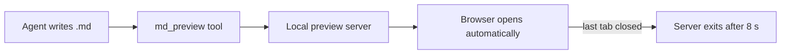
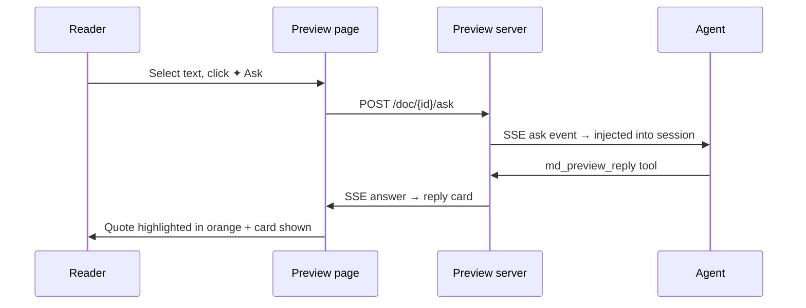

# pi-md-preview Feature Showcase

> This document is intended for screenshots and demos. It covers the main rendering and interaction features supported by pi-md-preview.

## Headings & Table of Contents

The left-hand table of contents appears automatically when the document has at least two headings. It highlights the current section while scrolling and smooth-scrolls on click.

### Third-level heading example

Body text supports **bold**, *italic*, `inline code`, ~~strikethrough~~, and autolinks — for example, typing https://github.com/MaphicalYng/pi-extension-md-preview directly produces a clickable link.

## Blockquotes & Admonitions

> A regular blockquote: typography matters. Structured content written by an agent deserves a proper reading interface.

> [!NOTE]
> This is a NOTE admonition, suitable for supplementary remarks.

> [!TIP]
> Tip: the toolbar lets you switch theme, reading background, font size and line height. Preferences persist to a user-level config file.

> [!WARNING]
> Warning: the preview server binds to 127.0.0.1 only, and the page makes no external network requests.

## Tables

| Feature | Implementation | Status |
| --- | --- | --- |
| GFM rendering | Zero-dependency built-in renderer | ✅ |
| Code highlighting | Lexical rules for 25+ languages | ✅ |
| Mermaid diagrams | Lazy-loaded same-origin runtime | ✅ |
| Live sync | SSE-push refresh | ✅ |
| Ask about selection | ask → SSE → reply card | ✅ |
| HTML export | Self-contained offline snapshot | ✅ |

## Task List

- [x] Render Markdown as a polished web page
- [x] Light / dark / follow-system themes
- [x] Bilingual UI (English / Chinese)
- [x] Server exits automatically after the last tab closes
- [ ] More paper-tone reading backgrounds (planned)

## Code Blocks

TypeScript (extension-entry style):

```typescript
import type { ExtensionAPI } from "@earendil-works/pi-coding-agent";

export default function (pi: ExtensionAPI) {
  pi.registerTool({
    name: "md_preview",
    description: "Render a Markdown file as a polished web page",
    async execute(_id, params) {
      const handle = await openDocument(params.file, params);
      return { content: [{ type: "text", text: handle.url }] };
    },
  });
}
```

Python:

```python
def quicksort(items):
    if len(items) <= 1:
        return items
    pivot = items[len(items) // 2]
    left = [x for x in items if x < pivot]
    mid = [x for x in items if x == pivot]
    right = [x for x in items if x > pivot]
    return quicksort(left) + quicksort(mid) + quicksort(right)
```

Shell:

```bash
# Install from npm, then restart your Pi session
pi install npm:pi-md-preview@0.2.0

# Try it once without installing
pi -e npm:pi-md-preview
```

JSON:

```json
{
  "file": "/path/to/report.md",
  "title": "Q3 Infrastructure Migration Report",
  "ui_lang": "en",
  "open_browser": true
}
```

## Mermaid Diagrams

Flowchart:



Sequence diagram:



## Images

Relative-path images are served safely as static assets:


## Lists & Nesting

1. Installation
   - `pi install npm:pi-md-preview` (npm package)
   - `pi install ./pi-extension-md-preview` (local checkout)
2. Usage
   - Agent calls the `md_preview` tool proactively (recommended)
   - User types the `/md-preview <file.md>` command
3. Lifecycle
   - Server starts lazily on first use
   - Exits 8 seconds after the last tab closes
   - Final safety exit when the session shuts down

## Markdown Link Routing

Relative links that point to other Markdown files open in-place as new previewed documents and join live sync — for example, [open the other test report](./preview-test-report.md). Links to images and other attachments are served as static assets.

## Divider & Other Elements

---

Toolbar overview: theme switcher (follow system / forced light / forced dark), reading-background swatches (white / dim / wood / cyan), font-size A- / A+ (0.7× – 1.6×), line-height stepper (1.4 – 2.2), 中 / EN language switch, Markdown source download, offline HTML snapshot export, page progress bar, and a scroll-aware back-to-top button.
